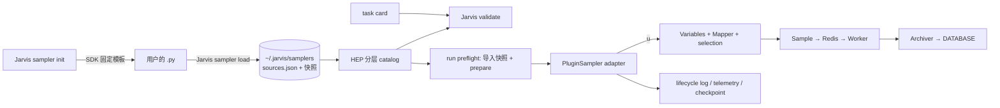

# Jarvis-HEP-Sampler — Technical Design

版本：**2.2**（2026-10-09，Australia/Adelaide）。产品方向保持定型；S1 收尾结果与剩余 S2/S3 范围见 §10–§11。
实施状态：

- **S0 初版已交付，S1 所需 SDK 补齐已验收**：SDK 位于 `Jarvis-Workshop/Jarvis-HEP-Sampler`（0.1.0，本地提交基线 `78a2cd2` 加未提交修正；未发布）。
- **S1 接入收尾已验收，尚未提交/发布**：R03–R10 已关闭，R13 的 S1 部分已完成；定向测试及真实 Redis 教程流程通过。全量 fast gate 仍有两项与既有基线相同的失败；P7 严格恢复、P8 打包不属于本阶段已通过的能力。
- **S2 未实现**：拆分为 S2a 外部插件恢复安全、S2b 可移植性与发布、S2c 内置方法推广。S3 仅预留元数据，不能运行。

审阅基线：Jarvis-HEP `0bbcf675` / `2.0.14` **加当前未提交实现**；SDK `78a2cd2`。结论不代表上述 HEP commit 已含插件支持。

1. **Roadmap phase**：外部 sampler 扩展 S0–S3。本次完成 S1 的实现修正、回归与 TeX 用户教程；本文继续维护唯一的目标、设计与开发台账。
2. **Affected modules**：新 distribution Jarvis-HEP-Sampler（SDK）；HEP 侧涉及 sampler_catalog、Distributor、cardload、runtime bootstrap/resume、新的 plugin adapter、lifecycle_log、telemetry、monitor、runtime_metadata、CLI（`Jarvis sampler`、`Jarvis man`）、project_packager。
3. **Public interfaces**：`Jarvis sampler init|check|load|list|info|remove`、一等 `Sampling.Method`、持久登记保持不变。`check --card` 保留 card 预算，checker 新增重新导入及新进程重启检查。`--accept-plugin-change`、`sampler_identity.json` 和插件打包仍待实现。
4. **Main risks**：配置改变仍能恢复旧游标，scan 副本仍按 mtime 选择（R01/R02）；公开安装、跨平台兼容和插件打包未验收（R12）。同步用户函数没有强制超时；慢 reporting hook 现在只阻塞采样线程，续租不再执行它。
5. **Verification performed**：SDK 146 passed；HEP 定向 56 passed / 24 subtests；全量 fast 1241 passed、2 failed、163 deselected / 141 subtests。TeX 示例在独立 CLI 进程完成 init→edit→check→load→validate/man/run→reload/remove，真实 Redis/spawn 完成并归档 1000 点。完整命令、证据与边界见 §10.6；跨平台 CI、严格恢复故障矩阵仍未执行。

AGENTS.md 指定的五份 canonical 文档在当前仓库不存在。本文是 Jarvis-HEP-Sampler 唯一的权威设计记录。

---

## 1. 目标与对等契约

### 1.1 目标

用户不修改 Jarvis-HEP 源码，只通过外部载入定义自己的 sampler。载入后，这个 sampler 的使用方式和行为与内置 sampler 完全相同：task card 写法、校验、Redis 发布、`sampler.log`、monitor、checkpoint/resume、手册和打包都一样。

与内置 sampler 唯一的区别：用户可以重新 `load` 同名插件，新版本覆盖旧版本。

这是发布目标，不是当前 0.1.0 / S1 工作区已经全部具备的能力。首个对外版本支持 independent profile；恢复与打包必须分别通过 S2a、S2b。重新 load 影响后续新 scan，不能改变已经启动或待续跑 scan 的绑定源码。

责任边界：用户负责算法、依赖、初始化及科学正确性，可以不写 schema、`validate_options` 或观测 hook。HEP/SDK 仍负责选对源码、校验恢复身份、如实记录来源、正确发布和归档点、报告失败与清理运行资源。不能把这些接入层责任归入“用户插件有 bug”。

### 1.2 对等契约

下表是 S1/S2 的验收标准，§9 的每一条测试都对应这里的一行。

| # | 用户可观察面 | 要求 |
| --- | --- | --- |
| P1 | task card | `Sampling.Method: <插件名>`，插件参数直接放在 `Sampling.Bounds`。没有任何额外字段 |
| P2 | `Jarvis validate` / `Jarvis man` | 未知方法的报错列出插件名；有 schema 时 Bounds 的报错和内置一样定位到 `$.Sampling.Bounds.<key>`；`Jarvis man sampler.<插件名>` 有自己的手册页。两条命令都不执行用户插件代码 |
| P3 | 采样执行 | 点经 Redis 发布给 Worker，backpressure、batch、selection、确定性 UUID 都走内置同一路径 |
| P4 | `sampler.log` | 标签 `Jarvis-HEP.Sampler.<插件名>`；S1–S11 的措辞、级别、表格格式与内置相同；没有 schema 或 hook 时也包含 card 显式提供的插件参数；插件自己应用的默认值由可选 hook 补充 |
| P5 | monitor | 显示进度、accepted、seed 和插件自报的指标，不出现 `CUSTOM METHOD` |
| P6 | run metadata | 记录实际执行的插件名、版本、源码 hash，以及 allowlist 内的 seed、预算；完整科学配置进入本地身份记录。续跑副本的来源不能被当前登记覆盖 |
| P7 | checkpoint / resume | 中断后续跑，坐标和 UUID 与不中断时逐位一致；改了 card 的科学配置时拒绝续跑 |
| P8 | 打包 | `Jarvis project pack` 带上 card 用到的插件 |
| P9 | 失败 | 插件出错时，S8 日志带插件自己的 traceback 和定位信息，scan 正常停止，不回退到其他 sampler |

### 1.3 非目标

- 不提供沙箱，也不对插件函数做强制超时。插件是用户自己的可信代码，由用户负责。
- 不承诺跨 Python/NumPy 版本逐位复现。只保证同一环境下的复现。
- 插件不能覆盖内置方法，也不能实现 CSV 这类不使用 `Variables` 的方法。
- 插件生成的点不会因为名字或标记就被当成后验样本（§8）。

---

## 2. 端到端示例

以用户方法 `MyLatinHypercube` 为例。官方 `LatinHypercube` 已是保留名，不能用于用户的 init/load；两者可以使用相同算法，但名称必须不同。以下日志与恢复流程描述目标体验，当前完成状态见 §10。

### 2.1 生成模板并修改

```text
$ Jarvis sampler init MyLatinHypercube
Created MyLatinHypercube.py from the independent sampler template.
Edit draw(), then run: Jarvis sampler load MyLatinHypercube.py
```

用户把模板改成：

```python
"""Latin hypercube design: one point per stratum in every variable."""

import numpy as np

PLUGIN = {
    "api_version": 1,
    "method": "MyLatinHypercube",
    "version": "0.1.0",
    "profile": "independent",
    "description": "Latin hypercube design with point_number strata per variable.",
}

OPTIONS_SCHEMA = {
    "type": "object",
    "properties": {
        "centered": {
            "type": "boolean",
            "description": "Put each point at the centre of its stratum.",
        },
    },
    "additionalProperties": False,
}


def prepare(setup):
    rng = setup.rng()
    perms = np.stack([rng.permutation(setup.point_number) for _ in range(setup.dimension)])
    return {"perms": perms, "centered": bool(setup.options.get("centered", False))}


def draw(context, rng, plan):
    strata = plan["perms"][:, context.candidate_index]
    offset = 0.5 if plan["centered"] else rng.random(context.dimension)
    return (strata + offset) / context.point_number


def settings_rows(setup, plan):
    return [("centered", plan["centered"])]
```

### 2.2 离线检查（可选）

```text
$ Jarvis sampler check MyLatinHypercube.py --dimension 2 --points 1000 --seed 7
MyLatinHypercube check ->
  prepare           ok   (0.4 ms)
  draw              1000 points, shape (2,), all in [0, 1]
  repeatability     same seed gives identical points
  options schema    valid
```

`check` 不需要 Redis，也不需要先 load。它只检查形状、范围和可重复性，不评价算法本身对不对。

### 2.3 载入

```text
$ Jarvis sampler load MyLatinHypercube.py
Loaded sampler MyLatinHypercube ->
  version          0.1.0
  profile          independent
  options schema   yes
  source           /home/alice/proj/bin/sampling/MyLatinHypercube.py
  snapshot         ~/.jarvis/samplers/user_sources/MyLatinHypercube-3f9a1c0d2e4b.py
```

载入之后，新开的终端也能直接用，不需要再 load。再次 load 同名插件会覆盖，输出里多一行 `replaced  0.1.0 (3f9a1c0d2e4b) -> 0.2.0 (8b7e…)`。

### 2.4 task card 与运行

```yaml
Sampling:
  Method: MyLatinHypercube
  Variables:
    - name: mass
      distribution: {type: Flat, parameters: {min: 100.0, max: 1000.0}}
    - name: coupling
      distribution: {type: Log, parameters: {min: 0.001, max: 1.0}}
  Bounds:
    seed: 7
    point_number: 10000
    centered: false
```

写法与 `Method: Random` 完全一样。`Jarvis validate` 和 `Jarvis run` 的行为与内置方法相同。`sampler.log` 摘录如下。第一条记录给出了完整的 V1 记录头，后面两条只列出正文：

```text

·•· Jarvis-HEP.Sampler.MyLatinHypercube
	-> 10-06 23:15:02.114 - [WARNING] >>>
Initializing the MyLatinHypercube Sampling

MyLatinHypercube Sampler Settings ->
Field        | Value
------------ | -----------------------------------------------------------------
method       | MyLatinHypercube
seed         | 7
variables    | 2 (mass, coupling)
workers      | 8
resume       | no
point number | 10000
plugin       | MyLatinHypercube 0.1.0 (3f9a1c0d2e4b)
centered     | False
...
MyLatinHypercube Sampler Summary ->
Field            | Value
---------------- | -------------------------------------------------------------
stop reason      | point_number reached
submitted        | 10000
completed        | 10000
failed           | 0
elapsed          | 2 h 13 min
candidates drawn | 10000
points submitted | 10000
```

monitor 的 sampler 面板显示 `PLUGIN 0.1.0 · ACCEPTED 4213 · SEED 7 · SAVED …` 和进度条。中断后用 `Jarvis run task.yaml --resume` 续跑，行为与 `Random` 相同（§7.4）。

---

## 3. 职责边界



**SDK（Jarvis-HEP-Sampler，import 名 `jarvis_hep_sampler`）负责插件格式本身：**

- 模板；
- `PLUGIN` 元数据规则和方法名规则；
- 从文件加载插件；
- `~/.jarvis/samplers/` 登记的读写；
- 随机流派生规则；
- 输出检查；
- 日志接口（只定义接口，后端由 HEP 注入）；
- independent profile 的唯一实现 `IndependentSession`：负责 options 检查、`validate_options`、`prepare`、按索引派生随机流、`draw_block` 块缓存和输出检查。HEP adapter 和离线驱动都调用它，所以 `check` 与真实 scan 产生同样的点；
- 离线参考驱动和一致性测试套件。

SDK 只依赖 Python 标准库、NumPy、jsonschema，不导入 HEP、Redis、Portal。

**HEP 负责运行时的一切：**

- `Jarvis sampler` 命令行；
- catalog 集成与 task card 校验；
- run preflight；
- u→物理量映射和 selection；
- Sample、UUID、Redis 调度和 backpressure；
- 归档、checkpoint/resume；
- lifecycle 日志、telemetry、monitor；
- 手册和打包。

**插件只负责生成单位立方体里的坐标**，不接触 Sample、UUID、Redis、Worker 或 DATABASE。

**依赖方向：** HEP 硬依赖 SDK（`Jarvis-HEP-Sampler>=0.1`），与 Portal 的处理方式一致；SDK 绝不导入 HEP。SDK 是单独的仓库，放在 `Jarvis-Workshop/Jarvis-HEP-Sampler/`，PyPI 名为 `Jarvis-HEP-Sampler`。

**命令行入口：** 只有一个，即 `Jarvis sampler ...`。模板、检查、加载的实现都在 SDK 里，SDK 不再单独提供命令行。

---

## 4. 插件契约（SDK API v1）

### 4.1 文件约定

一个插件是一个 `.py` 文件，包含以下模块级对象：

| 名字 | 必需 | 说明 |
| --- | --- | --- |
| `PLUGIN` | 是 | 元数据 dict（§4.2），必须可以 JSON 序列化 |
| `OPTIONS_SCHEMA` | 否 | Bounds 中插件参数的 JSON Schema（draft 2020-12）。缺失或为 `None` 时不检查这些参数 |
| profile 规定的函数 | 是 | independent profile 见 §4.3，generational profile 见 §4.6 |
| `validate_options(options)` | 否 | 语义检查，抛出异常表示不合法。在 run preflight 和 `check` 中调用 |
| `settings_rows` / `summary_rows` / `stop_reason` / `status` | 否 | 可观测性 hook（§4.5） |

用户不需要构造任何 descriptor 对象。插件可以导入当前 Python 环境里装好的任何库，依赖缺失时会在 load、check 或运行时报错。

插件也可以有模块级状态，HEP 不禁止。但 §7 的复现和续跑保证只在一个前提下成立：`draw` 的结果只依赖它的参数 `(context, rng, plan)`。

v1 的载入单位是单个 Python 文件，不复制同目录模块、数据文件或虚拟环境，也不修改 `sys.path`。复杂算法可以封装在当前环境已安装的包中，由该文件导入；源码快照只能固定入口文件。发布文档必须说明依赖安装和 `__file__` 随快照位置改变的行为，并提供一个导入外部包的示例。资源打包扩展不作为 v1 的隐式承诺。

### 4.2 `PLUGIN` 元数据

| 键 | 必需 | 取值 |
| --- | --- | --- |
| `api_version` | 是 | `1`。SDK 遇到不认识的 major 版本时拒绝加载 |
| `method` | 是 | 方法名，必须匹配 `^[A-Z][A-Za-z0-9]{1,63}$`，与全部内置方法名相同 |
| `version` | 是 | 非空字符串。作者用它声明"算法语义是否改变"，属于硬身份（§7.3） |
| `profile` | 是 | `"independent"`（S1）或 `"generational"`（S3） |
| `description` | 否 | 一句话说明，用于 `Jarvis man` 和 `Jarvis sampler list` |
| `statistical` | 否 | 默认 `False`。为 `True` 时，mapper 对维度扩张和非线性重参数化给出与统计类内置方法相同的警告（JV2-MAP-050/051） |
| `block_size` | 否 | 正整数。声明了它就必须提供 `draw_block`，不再要求 `draw`（§4.3） |
| `state_version` | generational 必需 | 正整数，状态格式的版本 |
| `feedback_return` | 否，仅 generational | 与 `Sampling.FeedbackReturn` 同构（`mode` 为 `minimal` / `fields` / `all_flat`，另有 `fields`）。缺省为 `{uuid, logL}` |

方法名规则：

- 与内置方法同名（不分大小写）时拒绝加载。
- 与已登记的插件同名（拼写完全一致）时，覆盖旧版本。
- 只差大小写时报错，要求先 `remove` 旧插件。

### 4.3 independent profile

候选点或块可按索引重建，生成结果与 Worker 数量、batch 大小、完成顺序都无关。`independent` 指不依赖 Worker 的评估反馈，不要求各点在统计上相互独立；LHS 和低差异序列可以有相关性。

```python
def prepare(setup: SetupContext) -> Any: ...                          # 可选
def draw(context: DrawContext, rng: np.random.Generator, plan) -> ArrayLike: ...
def draw_block(context: BlockContext, rng: np.random.Generator, plan) -> ArrayLike: ...
```

`draw` 和 `draw_block` 二选一：声明了 `block_size` 就用 `draw_block`，否则用 `draw`。

**`prepare` 在每次 scan 开始时调用一次，resume 时再调用一次。** 返回的 `plan` 可以是任意 Python 对象，不写进 checkpoint，所以必须完全由 `setup` 决定。没有 `prepare` 时，`plan` 为 `None`。`plan` 的内存开销由用户负责：例如 10⁶ 个点、20 维的置换表约 160 MB，可以改用 `int32` 或按索引计算的置换来节省。

**`draw` 对每个候选索引 `i ∈ [0, point_number)` 调用一次。** 返回长度为 `dimension` 的一维数组。

**`draw_block` 对每个块 `b` 调用一次。** 返回 `(block_size, dimension)` 的数组，覆盖候选索引 `[b·block_size, (b+1)·block_size)`；超出 `point_number` 的行由 adapter 丢弃。块边界只取决于插件声明的 `block_size`，与运行时的 `batch_size` 无关，所以生成结果与 batch 无关。适合 Sobol 这类按段顺序生成更高效的序列。

三种 context 都是 frozen dataclass：

| 字段 | SetupContext | DrawContext | BlockContext |
| --- | --- | --- | --- |
| `seed`、`point_number`、`dimension` | ✓ | `point_number`、`dimension` | `point_number`、`dimension` |
| `variable_names: tuple[str, ...]` | ✓ | ✓ | ✓ |
| `options: Mapping`（只读） | ✓ | ✓ | ✓ |
| `log`（§4.5） | ✓ | ✓ | ✓ |
| `rng()` | ✓（prepare 专用的随机流） | — | — |
| `candidate_index` | — | ✓ | — |
| `block_index`、`block_size` | — | — | ✓ |

- `options` 是 `Bounds` 去掉 HEP 保留键（§5.3）后的只读视图：list 变成 tuple，dict 变成只读 Mapping。options 进入 scan 身份，所以只接受 JSON 数据（字符串键、None、bool、int、有限 float、str、list、mapping），日期等其他类型报 `PluginConfigError`。
- `variable_names` 的顺序就是 `Variables` 的书写顺序。
- schema 的 `default` 不会自动填入。插件在代码里用 `options.get(key, default)` 自己给默认值。

### 4.4 输出契约

adapter 在建立 Sample 之前检查每个点：

1. 必须是一维（`draw`）或二维（`draw_block`）的数组或序列，形状完全匹配，不自动 flatten；
2. 元素必须是实数，不接受 bool、complex、字符串或 object；
3. 每个值都是有限数，且 `0 ≤ u ≤ 1`。闭区间与内置 Grid 一致；mapper 本身已经把无界分布的 u 夹到 `[tiny, 1−eps]`（`sampling/variables.py:14-15, 103-133`）；
4. 经 Variables 和 Mapper 映射后，每个物理量都是有限数。

任何一条不满足，就抛出 `PluginOutputError`，信息包含方法名、candidate_index、违规的分量和值，scan 停止。HEP 不会 clip，也不会替用户重抽。

### 4.5 可观测性

**日志。** 三种 context 都带 `log`。在 HEP 内，它写到 `Jarvis-HEP.Sampler.<Method>`，格式与内置相同；在 `check` 和离线驱动里，它写到标准 `logging`。可用的方法：

| 方法 | 对应 logging-spec | 级别 |
| --- | --- | --- |
| `log.step(title, rows)` | S5，每代或每个阶段一张表 | INFO |
| `log.adjust(name, old, new, why)` | S7，参数被修改、忽略或夹紧 | WARNING |
| `log.saved(what, path)` | S11，`<What> saved to <path>` | WARNING |
| `log.info(msg)` / `log.warning(msg)` / `log.debug(msg)` | 其他 | 同名 |

S1/S2/S3/S6/S8/S9/S10 由 runtime 独占写出，插件只通过下面的 hook 提供内容。

**hook（全部可选）：**

```python
def settings_rows(setup, plan) -> list[tuple[str, object]]: ...   # 追加到 S2 设置表
def summary_rows(plan, stats) -> list[tuple[str, object]]: ...    # 追加到 S10 总结表
def stop_reason(plan, stats) -> str | None: ...                   # S10 的停止原因
def status(plan, stats) -> dict[str, float | int | str]: ...      # monitor 指标
```

- `stats` 是只读的计数：`candidates`、`accepted`、`point_number`。
- `status` 最多 8 个标量键，字符串不超过 32 字符，整体受 telemetry 的 4 KiB 上限约束。超出的部分会被丢弃，不会让 telemetry 失败。
- hook 抛出的异常只记日志，不影响采样，这与 `lifecycle_log._hook_rows` 现有的处理一致。
- **S1 已实现的宿主约束（R03/R05）**：基础设置表由 adapter 记录显式 options，hook 补充默认/派生值，匹配的参数只显示一行；插件行最多 32 行，文本值最多 256 字符。SDK 每个 hook 每个 session 只告警一次，错误列表最多保留 16 条、每条 512 字符。`status` 在采样线程初始化及候选/等待安全位置计算，更新间隔至少 1 秒；租约/心跳线程只读快照，不执行用户代码或等待 hook。状态失败返回空插件指标，宿主计数继续有效；不要求插件线程安全，不引入强制超时。
- 停止原因必须来自真实状态。没有 hook 时，independent profile 的停止原因是 `point_number reached`；被中断时是 `interrupted`，由 runtime 判定。

### 4.6 generational profile（名称与元数据预留，运行语义在 S3 验收前冻结）

用于 MCMC 变体、优化器、自适应网格等需要反馈的算法。状态以纯函数方式传递：

```python
def init_state(setup) -> dict: ...                             # JSON 状态
def ask(state, context, rng) -> list[dict] | None: ...         # None 表示结束；[] 表示只记账、不发点的一代
def tell(state, context, results) -> dict: ...                 # 返回新状态
```

- **proposal** 的格式是 `{"u": [...], "tag": <小型 JSON，可选>}`。HEP 负责分配 id 和 UUID，插件不能自己生成 UUID。
- **results** 的顺序与 `ask` 返回的顺序一致，不按 Worker 完成顺序排列。每条结果是 `{"u", "tag", "status": "ok" | "failed", "logL": float | None, "fields": {...}}`，失败用 `status` 明确标出，不用 `None` 冒充 0。
- **状态**：`state` 必须是纯 JSON。HEP 在每一代结束（barrier）时把 `state` 和 generation 编号写进 checkpoint。不允许 pickle 外部对象；大型数值状态的格式留到 S3 再定。
- **随机流**：第 `g` 代的 rng 由 §7.1 派生，与运行时的并行度无关。
- **context**：包含 `generation`、`dimension`、`variable_names`、`options`、`log`。
- **HEP 侧实现**：adapter 复用 `FeedbackSampler` 的 barrier 循环（`feedback_sampler.py:438-469`）。`propose_generation` 对应 `ask`，`absorb_generation` 对应 `tell`，`feedback_return` 来自元数据。
- **预留**：async_chains profile（每条链异步推进）的名字已保留，v1 不开放。
- **S0 现状**：SDK 0.1 能校验 generational 的元数据（`state_version`、`feedback_return`），但加载时拒绝运行，提示要等后续版本。

以上是接口草案，不能作为已稳定的 ask/tell API。S3 必须先定义：`ask` 使用随机数后的新状态如何交给 `tell`；selection 拒绝、计算失败、缺失 score 如何逐 proposal 回传；空代的预算与停止规则；pending proposal、generation RNG 和 barrier 的 checkpoint 原子边界；`feedback_return` 与 card 的优先级。再用有拒绝、失败和中断的 toy 驱动验证。现有元数据校验不能证明任意 MCMC/优化器可接入。

### 4.7 错误类型

| 类型 | 触发场合 |
| --- | --- |
| `PluginLoadError` | 导入失败、`PLUGIN` 不合法、缺少必需函数、方法名冲突（load、check、preflight） |
| `PluginConfigError` | options 不符合 schema、`validate_options` 抛异常、`prepare` 抛异常 |
| `PluginOutputError` | `draw` / `draw_block` 抛出异常，或输出违反 §4.4 |
| `PluginResumeMismatch` | 续跑时身份不一致（§7.4） |
| `RegistryError` | `sources.json` 无法读取或格式不对、快照缺失或 hash 不符（HEP 侧报 JV2-PLG-002） |

所有错误都带方法名、插件快照路径、YAML 路径（例如 `$.Sampling.Bounds.centered`）、候选索引（如果适用），以及插件自己的 traceback。插件出错时 scan 停止，不回退到其他 sampler。

---

## 5. 登记、命名与校验

### 5.1 `Jarvis sampler` 命令

| 命令 | 行为 |
| --- | --- |
| `init <Method> [--output PATH] [--profile independent]` | 用 SDK 的固定模板生成 `<Method>.py`。检查方法名格式，检查是否与内置方法同名；目标文件已存在时拒绝。模板见 §5.5 |
| `check <file\|Method> [--dimension D \| --card TASK.yaml] [--options OPTIONS.yaml] [--points N] [--seed S]` | 离线执行参数/输出检查，重新导入后比较同 seed 流，并在新 Python 进程从中间候选重放尾段；覆盖 draw_block 的块边界。不需要 load；不能证明任意算法的科学正确性 |
| `load <file>` | 导入一次，按 §4.1–§4.2 检查结构；有 `OPTIONS_SCHEMA` 时运行 `check_schema`；然后写快照和登记。**不调用** `prepare` / `draw` |
| `list` | 表格列出方法、版本、profile、载入时间、源文件路径、状态（`ok` / `source changed since load` / `source missing`） |
| `info <Method>` | 显示登记的全部字段和插件提供了哪些 hook |
| `remove <Method> [--yes]` | 删除登记和快照。用户的源文件不受影响 |

**`check` 的 S1 语义（R06/R07 已验收）**：`--card` 与 `--dimension` 互斥；提供 card 时沿用变量顺序、seed、options 和 `point_number`，没有 card 时默认预算为 100。显式 `--points` 改变本次检查的总预算，输出显示有效配置与覆盖项；`--options` 替换插件 options。可重复性检查重新导入同一源码字节，并由 SDK 私有 worker 在新 Python 进程重放中间尾段。此处重启的是离线 session，不是 HEP 的 DATABASE/checkpoint 恢复验收；将来若增加部分检查上限，须另设参数并保留 context 原预算。

### 5.2 用户登记 `~/.jarvis/samplers/`

**位置。** 默认目录是 `~/.jarvis/samplers/`，可以用环境变量 `JARVIS_SAMPLERS_HOME` 覆盖（测试和 CI 用）。`~/.jarvis/` 已经是 HEP 的用户目录，`scan_refs.json` 和 `cache/` 都在这里。这套做法与 Jarvis-Operas 的 `~/.jarvis-operas/sources.json` + `user_sources/` 一致。

```text
~/.jarvis/samplers/
  sources.json
  user_sources/MyLatinHypercube-3f9a1c0d2e4b.py
  .lock
```

**`sources.json` 的格式：**

```json
{
  "version": 1,
  "entries": {
    "MyLatinHypercube": {
      "source_path": "/home/alice/proj/bin/sampling/MyLatinHypercube.py",
      "snapshot": "user_sources/MyLatinHypercube-3f9a1c0d2e4b.py",
      "source_sha256": "3f9a1c0d2e4b…",
      "loaded_at": "2026-10-06T23:10:00+10:30",
      "sdk_version": "0.1.0",
      "plugin": {"api_version": 1, "method": "MyLatinHypercube", "version": "0.1.0", "profile": "independent", "description": "…"},
      "options_schema": {"type": "object", "properties": {"centered": {"type": "boolean"}}},
      "hooks": ["prepare", "draw", "settings_rows"]
    }
  }
}
```

**写入规则：**

- 写之前用 `.lock` 加文件锁（`fcntl.flock`），把多个终端同时 load 串行化。
- 先写同目录的临时文件，再 `os.replace` 替换。
- 覆盖同名插件时，删除旧快照。与 Operas 不同，旧快照不会越积越多。

**快照语义。** HEP 运行时只用快照，不用用户正在改的工作文件。改了文件但没有重新 load，修改不会生效；`Jarvis sampler list` 会把这种情况标成 `source changed since load`。

**一致性检查。** 读取登记时，如果快照文件不存在，或快照的 hash 与 `source_sha256` 不符，就报 JV2-PLG-002，提示重新 load。

**可移植性。** 登记是"每个用户、每台机器"一份。在另一台机器上运行同一张 card，需要先 load，或者从打包的项目里拿到插件（§6.7）。

### 5.3 Bounds：保留键与插件参数

| 键 | 归属 | 规则 |
| --- | --- | --- |
| `seed` | HEP，所有 profile | 非负整数，`0` 有效，不接受 bool。默认 `0`，与内置方法相同 |
| `point_number` | HEP，independent 专用 | 正整数，表示候选点的数量（被 selection 拒绝的点也计入），必需 |
| `max_worker` | HEP | 与 FixedSetSampler 相同，是运行时的 inflight 上限，不进入身份 |
| 其余所有键 | 插件 | 组成 `options` |

插件的 `OPTIONS_SCHEMA` 只描述自己的参数，不需要声明保留键。HEP 先检查保留键，再把剩下的键交给插件 schema。

### 5.4 校验与 preflight

**`Jarvis validate` 和 `Jarvis man`** 对用户插件只读登记元数据及必要的快照完整性信息，不导入用户插件：

- 方法不存在：JV2-MTH-003，可选方法列表里包含已登记的插件，并提示 `Jarvis sampler list` 和 `Jarvis sampler load <file>`。
- 保留键错误：JV2-PLG-003。
- 有 schema：用它检查插件参数，违反时报 JV2-PLG-004，路径为 `Sampling.Bounds.<key>`。
- 没有 schema：给一条 info 级的 JV2-PLG-001，说明插件参数原样传递、未检查。不是 warning，因为不写 schema 是用户的合法选择；`--strict` 也不会让它失败。
- 登记损坏或快照不符：JV2-PLG-002。

插件参数的检查直接用登记里的 `options_schema` 调 SDK 的 `schema_issues`，不注入 bundled schema 的 `lru_cache` registry（`cardload/task_schema.py:86-107`）。

schema 仍然完全可选。S1 已修正 man 的解析根，本地 `$defs` / `$ref` 的类型、说明和默认值与校验一致。SDK 禁止引用解析时自动访问网络：无法解析的本地引用或外部资源引用返回定位明确的离线诊断。需要复用 schema 时把定义放进同一文档；schema 默认值只供展示，不自动写入 options，插件自行应用默认值（R09 已验收）。

**`Jarvis run` 的 preflight** 插在 `_runtime_supervisor.bootstrap_distributed_runtime` 里 `check_environment_requirements()` 之后、`prepare_libraries` 和 `init_redis()` 之前。导入、参数及初始化阶段的问题会在 Redis、Worker、Archiver 启动之前暴露；draw 的错误在执行时报告。目标顺序为：

1. 确定这次用哪份源码（§7.4）；
2. 核对将执行的源码字节与绑定 hash，恢复时先完成身份检查（S2a）；
3. 从同一份字节导入；
4. 调用 `validate_options`；
5. 调用 `prepare`。

内置方法的 preflight 什么都不做，行为不变。之后 `init_sampler_from_config()`（`:114`）直接使用 preflight 已经导入的模块和 `plan`。插件只在 control 进程里导入，Worker 永远不导入插件。

实现为 `core.preflight_sampler_plugin()`，调用 `sampling/plugin_sampler.preflight_plugin`。失败时在 `sampler.log` 写 `<Method> Sampler meets error when preparing the plug-in -> …`（带插件自己的 traceback），并标记为已记录，避免 core 重复写一遍。

### 5.5 固定模板（independent）

`Jarvis sampler init` 生成的文件如下，`<Method>` 会被替换成用户给的名字：

```python
"""<Method>: one-line description (shown by Jarvis man sampler.<Method>)."""

import numpy as np
from jarvis_hep_sampler import DrawContext, SetupContext

PLUGIN = {
    "api_version": 1,
    "method": "<Method>",
    "version": "0.1.0",
    "profile": "independent",
    "description": "One-line description.",
    # "statistical": False,
    # "block_size": 64,          # declare it to use draw_block() instead of draw()
}

# Optional. Delete it, or set it to None, to leave the Bounds options unchecked.
OPTIONS_SCHEMA = {
    "type": "object",
    "properties": {
        "upper": {
            "type": "number",
            "exclusiveMinimum": 0,
            "maximum": 1,
            "description": "Upper edge of the scanned unit cube.",
        },
    },
    "additionalProperties": False,
}


def prepare(setup: SetupContext):
    """Run once per scan, and again on resume. Return what draw() needs."""
    return {"upper": float(setup.options.get("upper", 1.0))}


def draw(context: DrawContext, rng: np.random.Generator, plan) -> np.ndarray:
    """Return one point: shape (context.dimension,), values in [0, 1]."""
    return rng.random(context.dimension) * plan["upper"]


# Optional hooks. Delete the ones you do not need.
# def validate_options(options): ...
# def settings_rows(setup, plan): return [("upper", plan["upper"])]
# def summary_rows(plan, stats): return []
# def stop_reason(plan, stats): return None
# def status(plan, stats): return {}
```

---

## 6. HEP 集成

### 6.1 分层 catalog

`sampler_catalog.py` 成为唯一的查询入口，由三层组成：

| 层 | 来源 | 能否覆盖 |
| --- | --- | --- |
| builtin | 现有的 `_SPECS` | 不能 |
| builtin-plugin | 随 HEP 发布、用插件格式写的方法（§6.6） | 不能 |
| user | `~/.jarvis/samplers/sources.json` | 重新 load 时覆盖 |

**`SamplerSpec` 的变化。** 新增字段 `source`（取值 `builtin` / `builtin-plugin` / `user`）和属性 `is_plugin`。插件的登记内容不放进 spec，而是由 `plugin_record(method)` 单独返回一个 `PluginRecord`（版本、profile、description、`options_schema`、hooks、源文件、快照路径、hash）。user 层从登记读出，不执行插件代码；builtin-plugin 层在第一次需要时加载包内文件一次。插件的 spec 由元数据生成：

- `stateless = (profile == "independent")`；
- `statistical` 取自元数据；
- `needs_variables = True`；
- `nested = mcmc = False`。插件不会触发 nested 结果 CSV 导出，也不会触发 MCMC 诊断；
- `family = "plugin"`。

**user 层的读取。** 按 `sources.json` 的 mtime 和 size 缓存，只读 JSON，因此 catalog 仍然可以在 validate/man 阶段安全导入。

**查询函数。** `spec_for`、`names`、`available_methods`、`is_stateless`、`statistical_names`、`family_of` 等都改成在调用时合并三层；新增 `canonical_name`（大小写不敏感）、`is_plugin`、`is_statistical`、`plugin_record`、`reserved_method_names`、`user_registry_error`。`builtin_specs()` 和 `schema_ids()` 仍只覆盖 builtin 层：只有内置方法有 bundled schema 和 Distributor factory。

**去掉 import 期冻结的名字集合（实际改法）：**

| 位置 | 现状 | 改为 |
| --- | --- | --- |
| `runtime/core.py:879` | `method in STATELESS_METHODS` | 调用处不变；`distributor._StatelessMethodsView` 对未注册 factory 的名字改查 catalog |
| `cardload/contracts/mapper.py:118` | `STATISTICAL_METHODS` | 调用时 `is_statistical(method)`；`mapper.STATISTICAL_METHODS` 保留作兼容导出 |
| `cardload/contracts/methods.py` | `_METHODS_NEED_VARIABLES` 冻结集合 | `method_needs_variables` 调用时查 spec |
| `logging/toplevel.py:132-152` | 日志标签的规范拼写在 import 时生成 | 表内查不到的全小写/全大写段，调用 `canonical_name`（带 LRU 缓存） |
| `monitor/queues.py:23-33` | 硬编码的反馈族集合 | 内置名单之外查 spec：independent 插件为 `inactive`，generational 为 `shared` |

`runtime/worker_config.py:126-130` 已经调用 `is_stateless(method)`，catalog 分层之后自动适用于插件。

**测试隔离。** `tests/conftest.py` 在测试会话开始时把 `JARVIS_SAMPLERS_HOME` 指向临时目录，测试永远不读开发者自己的 `~/.jarvis/samplers`。

### 6.2 Distributor 与 adapter

**`Distributor.set_method`。** 内置方法的 factory 不变。没有 factory 的名字查 catalog：插件方法由 `create_plugin_sampler(spec)` 构造 `PluginSampler`；未知方法的报错提示 `Jarvis sampler load <file>`。`Distributor.available_methods()` 是注册的 factory 加上 catalog 里的插件方法。`register_builtin_samplers` 的漂移检查只覆盖 builtin 层。

**preflight 的交接。** `core.init_sampler_from_config` 在 `set_config` 之前调用 `sampler.attach_preflight(core._plugin_preflight)`，adapter 直接使用 preflight 已导入的模块、已执行的 `prepare` 和身份。没有 preflight 时（直接在 Python 里用、测试），`set_config` 自己调用 `preflight_plugin(config)`，只是不写 scan 级副本。

**`jarvishep2/sampling/plugin_sampler.py`（新文件）** 里的 `PluginSampler(FixedSetSampler)` 负责 independent profile：

- **基本属性**：`method` 取元数据里的方法名。`uuid_prefix = f"plugin:{method}:{hard_identity[:16]}"`，再交给已有的 `deterministic_sampler_uuid`。
- **`set_config`**：沿用 FixedSetSampler 的逻辑（变量、mapper、selection、seed、batch、inflight），再读 `point_number`，并组装只读的 `options`。
- **`propose_next`**：与 `RandomS.propose_next` 结构相同。差别只在 u 的来源：调用 SDK 的 `IndependentSession.point(i)`，由它完成 `draw` 或块缓存，以及 §4.4 的输出检查。adapter 之后依次执行映射、物理量有限检查、selection、accepted 编号和确定性 UUID。进度条用 `PermilleProgress`，标签是 `<method> candidates sampled`。
- **checkpoint**：只保存两个游标 `_index` 和 `_accepted_index`，外加身份。不需要保存随机数状态，因为每个点的 rng 都由索引派生（§7.1）。续跑时，`prepare` 由 preflight 重新计算；`advance_to_persisted_prefix` 沿用 FixedSetSampler 的重放逻辑。
- **日志 hook**：
  - `log_settings_rows` 返回预算、`plugin <method> <version> (<hash12>)`、selection 和 card 显式 options，再用可选 `settings_rows` 补充默认/派生值；重复参数合并，展示受 §4.5 的大小限制。
  - `log_summary_rows` 返回 FixedSetSampler 的行，再加上插件的 `summary_rows`。
  - `log_stop_reason` 优先用插件的 `stop_reason`，否则是 `point_number reached`。
  - 三个 hook 经 session 的同名方法转发；异常每个 hook/session 只记一次 WARNING。`status` 由采样线程更新缓存，telemetry 只读宿主快照。
- **日志后端**：`JarvisLogBackend` 把 SDK `log` 绑定到 `Jarvis-HEP.Sampler.<Method>` 和 `format_two_column_log`。
- **checkpoint 身份核对（S1 部分）**：checkpoint payload 带 `plugin.identity`；导入时身份不一致只写 WARNING。拒绝续跑的规则在 S2a 实现（§7.4）。
- **运行总结**：`[Scan Performance]` 的 sampler 一栏对插件写方法名（内置方法仍是类名）。

generational profile 的 adapter 放在同一个文件里，在 S3 实现（§4.6）。

### 6.3 校验与 issue code

- **`cardload/contracts/plugin.py`（新）**：`validate_method_sampling` 遇到插件方法时，在 Variables 检查之后改走这里，不再进入内置方法的分支。插件方法没有 bundled schema，`task_schema` 的 method schema 分派自然跳过它们。
- **`cardload/task_validation.py`**：未知方法报 **JV2-MTH-003**（JV2-MTH-002 是"没写 Method"），suggestion 提示 `Jarvis sampler load`，大小写写错时给出正确拼写，登记无法读取时附上原因。
- **新的 `info` 级别**：`Level` 增加 `"info"`，`ValidationReport.notes()` 返回它们。info 不计入 errors/warnings，不影响 `ok`，`--strict` 也不会把它升级为 error。`Jarvis validate` 成功时打印 notes；run 路径把 notes 写进 `core.log`（INFO）。
- **`man_codes.py`**：登记四个新 code，都指向 sampler 手册：
  - JV2-PLG-001（info）：插件没有 `OPTIONS_SCHEMA`，它的参数原样传递、不做检查；
  - JV2-PLG-002（error）：快照缺失或 hash 不符，或登记无法读取；
  - JV2-PLG-003（error）：HEP 保留键（`seed`、`point_number`、`max_worker`）不合法；
  - JV2-PLG-004（error）：插件参数违反 `OPTIONS_SCHEMA`，或不是 JSON 数据。未知参数报在它自己的路径上，并给出最接近的已知参数名（SDK `schema_issues`）。

### 6.4 日志、telemetry、monitor、run metadata

- **`sampling/lifecycle_log.py`**：不需要改。插件经 adapter 提供三个 hook，标签由 `sampler.method` 得到，即 `Jarvis-HEP.Sampler.<Method>`。
- **`sampling/telemetry.py`**：有 `plugin_status()` 的 sampler 走插件分支。
  - progress 为 `finite`（`_index` / `_maxp`）；
  - metrics 包含 `accepted`、`seed`；插件 `status()` 的结果放在 `metrics["plugin_status"]` 下，与 adapter 自己的字段分开；
  - payload schema 不变（仍为 1）。
- **`monitor/samples.py`**：按 run metadata 的 `family == "plugin"` 选择通用插件布局，不按方法名。
  - 前两行与 Random 相同：`CANDIDATES n / point_number` 和进度条；
  - 副标题为 `PLUGIN <version> · ACCEPTED n · SEED s · <插件指标，最多两个> · SAVED …`；
  - `CUSTOM METHOD` 只留给既不是内置、也不是插件的方法。
- **`runtime_metadata.py`**：插件 knobs 的 allowlist 为预算、seed、插件版本、源码 hash12 和完整 `source_sha256`。运行 supervisor 从当次 preflight 取得实际执行来源，重新 load 不会改写这次运行的版本/hash（R04 已验收）。插件 options 不进入 run metadata；完整科学身份的持久绑定仍由 S2a 实现。

### 6.5 CLI 与手册

- **新文件 `jarvishep2/cli/sampler.py`**：实现 `dispatch_sampler`。在 `cli/client.py` 的意图路由中注册 `sampler`，在 `cli/help.py` 中加帮助，归到 "Extensions & projects" 分组，与 `project` 放在一起。
- **`cli/man.py`**：`Jarvis man sampler.<插件名>`（大小写不敏感）由登记内容生成手册页，不执行插件代码。内容包括：
  - 说明，取自 `description`；没有 `OPTIONS_SCHEMA` 时注明参数不做检查；
  - Capabilities：type plugin、profile、版本、来源（用户文件路径，或 "shipped with Jarvis-HEP"）；
  - 保留键 `seed`、`point_number`，以及由 `OPTIONS_SCHEMA` 生成的参数表（类型、description、default）；
  - 自动生成的 `Sampling` 示例（带上 schema 里有 default 的参数）；
  - 相关诊断 JV2-PLG-002/003/004。

  `Jarvis man sampler` 的索引按 (type, method) 排序，插件标为 plugin 族；插件 description 超过 50 字符时截断，保持索引一行一项。
- **`--accept-plugin-change`**（S2a 待实现）：加入 run 参数，只能与 `--resume` 一起使用，并须通过 §7.3–7.4 的一致性核对。

### 6.6 Dogfooding：官方的 `LatinHypercube`

与 §2.1 用户示例算法相同的官方 `LatinHypercube` 随 HEP 发布，文件位于 `jarvishep2/sampling/plugins/latin_hypercube.py`，在 catalog 的 builtin-plugin 层登记，名字受保护。它只使用公开的 SDK API，经由 `PluginSampler` 执行。它用于持续覆盖插件路径，但不能代替 user 层的加载、覆盖、无 schema、无 hook 和恢复故障测试。

`Random` 不迁移。它依赖全局 NumPy 随机状态，迁移会改变已有 scan 的轨迹。

### 6.7 打包

**S2b 待实现。** `project_packager` 在打包 share、repro、full 三种 profile 时：

- 找出 card 用到的 user 层插件，把它们的快照放进包内的 `.jarvis-pack/samplers/<Method>.py`；
- repro/full 导出已有 scan 时，以 scan 绑定的源码为准，不取用户后来 load 的版本；包内清单记录完整 hash、插件/API 版本和已知环境信息，fetch 时核对完整性；
- `Jarvis project fetch` 或解包之后，列出所需插件。未登记或同名但 hash 不同时，打印包内来源与 `Jarvis sampler load <path>` 提示；不能因为本机已有同名就静默跳过。

不会自动 load。登记属于用户本机的状态。

验收必须在空登记目录、无 sibling checkout 的干净环境中完成，并覆盖同名不同版本；提示安装插件导入的依赖。源码入口与依赖环境是两项不同的可移植性要求，单个 `.py` 快照不代表环境已打包。

---

## 7. 随机性、预算与恢复

### 7.1 随机流

所有随机流都从 `Bounds.seed` 派生，使用显式的 PCG64，不依赖 `default_rng` 将来的默认算法：

```python
STREAM_PROTOCOL = 1

def stream(seed: int, *key: int) -> np.random.Generator:
    seq = np.random.SeedSequence(seed, spawn_key=(STREAM_PROTOCOL, *key))
    return np.random.Generator(np.random.PCG64(seq))

# prepare:            stream(seed, 0)
# 第 i 个候选点（draw）: stream(seed, 1, i)
# 第 b 块（draw_block）: stream(seed, 2, b)
# 第 g 代（generational）: stream(seed, 3, g)
```

每个点的坐标只由 `(seed, 索引, plan)` 决定，与 Worker 数、batch、完成顺序都无关。代价是每个候选点都要构造一次 SeedSequence 和 PCG64，§9 的性能 gate 会测量这部分开销。

保证范围：在同一个 Python/NumPy/插件依赖环境下逐位复现；跨版本只记录差异，不做保证。

### 7.2 预算与两种索引

- `candidate_index` 统计所有候选点，包括被 selection 拒绝的；`sample_index`（accepted）只统计进入 Worker 的点。
- 候选预算用完就停止，不会为了凑够 accepted 数量而继续抽点。
- selection 全部拒绝时正常结束：candidates 等于 `point_number`，submitted 等于 0，日志里照常有 summary。
- 被 selection 拒绝的点没有 UUID，也不进入 Worker。selection 表达式本身出错属于配置错误，不会被当作拒绝。
- 物理计算失败的点照样占用 accepted 编号，归档为 Failed。

### 7.3 身份

**硬身份（`hard_identity`，目标定义）** 是以下内容 canonical JSON 的 SHA-256。当前实现缺少生成模式/块长等保护，见 R01：

- 方法名、插件 `version`、profile、`api_version`、`state_version`、`STREAM_PROTOCOL`；
- profile 的生成模式（`draw` / `draw_block`）及 `block_size`；后者决定块随机流，不能被当作仅影响性能的 batch 参数；
- `Variables`（按书写顺序）、`Mapper`、`selection`；
- `seed`、`point_number`、`options`。

身份记在两个地方：

- **DATABASE 目录**：`<database_dir>/sampler_identity.json`，内容包括硬身份 hash、它的全部输入字段、源码 hash、SDK/Python/NumPy 版本。全新 scan 在 Archiver 启动之前，由 control 进程原子写入。之所以用独立文件而不是 HDF5 属性，是因为 control 进程不能以追加模式打开 `samples.hdf5`，否则会和 Archiver 的写锁冲突（`_runtime_supervisor.py:76-90`）。
- **checkpoint payload**：包含同样的身份字段。

**软身份** 是源码 hash（插件 `version` 不变的情况下）、SDK 版本、Python 版本、NumPy 版本。

UUID 前缀只取自硬身份。相同 UUID 只能证明编号相同，不能证明切换源码后的坐标相同。`--accept-plugin-change` 不得绕过硬身份检查；启用前还必须定义并实现对已持久化点（包括 prefix 之外的点）的重放一致性核对，无法核对或坐标/accepted 对应改变时应要求新 scan。源文件字节改变后不能继续宣称原源码的逐位复现保证。

### 7.4 续跑规则

每个 scan 开始时，preflight 把当次使用的插件源码复制到 `<task_root>/checkpoints/<scan>/<Method>/plugin/<Method>-<hash12>.py`（与 `state.pkl` 在同一目录，见 `runtime_checkpoint.checkpoint_path`）。目标是由身份记录绑定确切路径与完整 hash，而非按目录 mtime 猜测。首次初始化全部成功后才提交绑定；失败不能改变已有 scan 的来源。重新 load/remove 用户登记不删除 scan 副本；恢复入口的解析与校验也须支持从 scan 绑定读取元数据（当前仍依赖 catalog 登记）。

`--resume` 的判断规则如下。先只读取得 scan 身份与源码绑定，用其中的元数据解析恢复配置；验证成功后才能导入游标和执行恢复副作用：

1. **核对硬身份。** 在导入 checkpoint 游标、跳过 DATABASE prefix 或启动有写入副作用的运行资源之前完成比较。不一致就抛出 `PluginResumeMismatch`，列出不一致的字段，提示换一个 scan 名重新开始。这一步不能覆盖，也不能用旧 checkpoint 的预算/seed/selection 覆盖当前 session。当前 bootstrap 先读 DATABASE 状态，S2a 须调整这条时序。
2. **没有身份文件。** 插件方法的 DATABASE 非空却没有 `sampler_identity.json` 时，拒绝续跑。
3. **选择源码。** 依据 scan 的身份记录，先定位并核对完整 hash，再导入其副本。副本缺失时只有 hash 完全相同的登记快照可自动补回；副本 hash 不符时拒绝。登记有更新时写 S7，仍使用 scan 副本；登记已删除但 scan 绑定完整时仍应可续跑。`--accept-plugin-change` 的显式切换须另通过 §7.3 的核对，并记录来源变更。
4. **环境版本不同。** 只写 S7 WARNING，继续运行。

**S1 已实现的部分：**

- scan 级源码副本（每次运行都写；内容相同时不重写）；
- 续跑时优先使用副本，取修改时间最新的一份；与登记版本不同时写 WARNING；
- 硬身份的计算（`plugin_sampler.plugin_identity`）和由它派生的 UUID 前缀；
- checkpoint payload 带身份，导入时不一致只写 WARNING。

这些只是实现事实，**不是 P7 已通过**。2026-10-08 审阅复现了旧预算 8 / 新 session 预算 2 的混合状态，以及初始化失败留下的副本被下一次 resume 选中，S1 收尾没有修复这两项。无 checkpoint 时也必须检查 DATABASE 身份；恢复失败不能降级为“从当前登记重新采样然后跳过旧 prefix”。

**留给 S2a：**

- `sampler_identity.json`、源码 hash 绑定及生成模式/块长的硬身份；
- 身份不符、记录缺失、损坏副本、重放不足的拒绝规则，以及无登记时的恢复入口；
- `--accept-plugin-change`；
- 环境版本记录。

续跑的机制本身沿用现有实现：

- 只从 `accepted ≤ DATABASE 连续 prefix` 的安全快照恢复；
- 从快照出发，重放候选点和 selection，直到 accepted 等于 prefix，这样就能对齐候选游标；
- 已经持久化的 UUID 不再提交；
- prefix 之外已经持久化的行，按现有的去重机制处理；
- 重放过程中不输出进度刷屏。

续跑是 at-least-once 语义：物理计算可能重复执行，但归档按 UUID 去重。

### 7.5 推广到内置方法（S2c，外部插件恢复闭环之后）

`sampler_identity.json` 和硬身份检查再推广到内置方法；逐方法列出科学键、运行时键及旧数据库兼容策略，不能用一个泛化规则视为全部验证完成。内置方法的硬身份包括方法名、Variables、Mapper、selection、seed，以及 Bounds 去掉运行时键后的部分。运行时键由 catalog 的 `identity_exclude` 声明，例如 `max_worker`。旧 DATABASE 没有身份文件时只能标为历史身份未知；若允许告警后建立新基线，不能宣称已验证先前配置。内置方法的 `uuid_prefix` 保持不变。此推广不阻塞外部 SDK 的首个可用版本。

### 7.6 中断与开销

- **中断（S1 已实现，R10）**：FixedSetSampler 在批次、候选点、prefix 重放和 backpressure 等待中检查中断；runtime 绑定自己的中断标记。Redis proc board 的 paused/stopping/draining 状态最多每 0.1 秒读取一次。PluginSampler 也在每次 draw/status 返回后检查控制状态，selection 连续拒绝不会绕过检查。单次用户函数仍是同步调用，不承诺强制超时；Ctrl+C 清理与协作停止的证据分别记录在 §10.6，严格恢复另属 S2a。
- **内存**：上界为 `O(max_inflight · dimension + block_size · dimension + 快照窗口)`，再加上插件的 `plan`。adapter 不保存候选点到 accepted 的终身映射。
- **重放时间**：续跑的重放时间是 `O(候选 prefix)`。selection 很稀疏时会比较长，但不能为了加速跳过 selection。

---

## 8. 科学语义

- independent profile 是扫描 API：生成待评估的点。用户生成的偏置分布、相关点、低差异序列，都不会自动成为后验样本。`statistical=True` 只影响 mapper 的警告，不让 HEP 把结果当作后验处理。
- generational profile 的算法正确性由插件作者负责，包括 MCMC 的接受率与 Hastings 修正、越界拒绝、优化目标的方向等。HEP 只保证以下几点：
  - 结果按 `ask` 的顺序交给 `tell`；
  - 失败有明确的状态；
  - 状态在 barrier 上保存；
  - 恢复后不跳点。
- 停止原因必须来自实际状态，不能根据 finished 标志推测"已收敛"。`recent-code-review.md` 的 F3 是现有 nested sampler 的反例。

---

## 9. 测试与验收

### 9.1 SDK（S0）

- `PLUGIN` 元数据校验和方法名规则；
- 模板生成，并能通过一致性测试；
- 输出契约：`(1,d)`、bool、complex、字符串、NaN、Inf、负数、大于 1 都要拒绝；0 和 1 要接受；
- 随机流：同一 seed 逐位相同；`draw` 与 `draw_block` 的块边界不随运行时 batch 变化；
- 登记：原子写、并发 load 时的锁、同名覆盖时删除旧快照、只差大小写时报错、`remove`、快照损坏时报错；
- `testing.check_plugin`（`Jarvis sampler check` 使用）与 `assert_conforms`（pytest 使用）；`run_offline`；`reference_stream`（HEP adapter 测试的参照序列）；
- SDK 内不出现任何 `jarvishep2` 导入。

### 9.2 HEP 对等验收（S1/S2）

| 对等项 | 测试 | 判定标准 |
| --- | --- | --- |
| P1/P2 | 用临时 `JARVIS_SAMPLERS_HOME` load 测试插件，再 validate 一张只写 `Method` 的 card | 通过；拼错的参数在有 schema 时报到 `$.Sampling.Bounds.<key>`，没有 schema 时只有 JV2-PLG-001 |
| P2 | 插件顶层代码写一个 marker 文件 | `validate`、`man`、`list` 都不产生 marker |
| P3 | seed 固定，batch 取 1/16/64，workers 取 1/4 | 按 sample_index 比较，u 和 UUID 逐位一致 |
| P3 | selection 拒绝前两个点和中间的点；selection 全部拒绝 | 候选和 accepted 序列与参考枚举一致；全部拒绝时在有限时间内结束，并写出 summary |
| P4 | 现有 `tests/test_sampler_logging_contract.py` 遍历 catalog，覆盖 builtin-plugin 的 LatinHypercube 和一个 user 插件 | S1/S2/S3/S6/S9/S10 全部通过，设置表包含插件参数 |
| P5/P6 | telemetry payload 快照；monitor 渲染快照 | 出现 plugin 布局和指标，没有 `CUSTOM METHOD` |
| P7 | 中断后续跑 vs 不中断；DATABASE 有空洞；部分 batch 失败；checkpoint 之后只剩 selection 拒绝的尾巴 | 坐标和 UUID 逐位一致；prefix 不越过空洞；每个点只归档一行；尾部不重跑物理计算 |
| P7 | 两次运行之间重新 load/remove 插件；副本缺失、损坏或有多个副本 | 根据身份绑定恢复，完整 hash 不符则拒绝；登记更新不影响旧 scan；改 options、Variables、生成模式或 block_size 时拒绝。源码显式切换另按 §7.3 验收 |
| P8 | 打包一个使用 user 插件的项目 | 包里有快照；fetch 之后打印 load 提示 |
| P9 | `prepare` 抛异常；`draw` 返回 NaN 或越界 | 在 Redis 启动前，或在第一个违规点处停止；日志有插件 traceback 和定位信息 |
| Worker | 真实 spawn 的 Worker | Worker 进程不导入插件模块，物理结果正常 |

### 9.3 运行环境与性能

- **CI 矩阵**：Python 3.10–3.13，Linux 和 macOS；NumPy 1.24 与 2.x 的合法组合。逐位比较只在同一环境内进行。真实 Redis 和 spawn 的测试标记为 `slow`，不能用 fakeredis 单测代替。
- **性能 gate（尚无测量证据）**：分别测 2、20、200 维，各 10⁵ 次 draw。adapter 的额外开销（随机流、检查、映射，不含插件自己的 `draw`）中位数 20 μs/点是待校准目标，须同时记录硬件、软件版本、基线和 p95，不能先作为已达标指标。另外报告物理计算耗时为 1 ms、100 ms、1 s 三档时的吞吐，以及有重复 hook 错误时的 RSS/日志增长。

---

## 10. 路线与开发台账

### 10.1 阶段状态与退出条件

“已实现”指代码存在；“已验收”必须有对应测试结果；“已发布”必须有用户可安装的构件与版本。三者分别记录。当前不能把 S1 的路径覆盖概括为 P1–P9 全部通过。

| 阶段 | 当前状态 | 退出条件 |
| --- | --- | --- |
| **S0 SDK 初版** | 初版已提交 `0e841bd`、`78a2cd2`；S1 补齐在工作区验收通过，未提交/发布 | contexts/loader/registry/session/template/testing 及 R03/R05/R07/R08/R09 的 SDK 修正通过 146 项测试；公开构件与兼容矩阵仍属 S2b |
| **S1 HEP 接入** | 收尾验收完成；HEP/SDK 改动尚未提交，未发布 | R03–R10 已关闭；R13 的参数解析与本阶段证据已完成。定向、真实 Redis 教程及 Ctrl+C 通过，TeX 第 38 章已接入。全量 fast 两项既有失败未关闭，不等于全仓 gate 通过；严格恢复依赖 S2a |
| **S2a 外部插件恢复安全** | 未实现；首个对外版本的必要 gate | 关闭 R01/R02；身份、源码绑定、实际执行来源贯通；通过 P7 的真实中断/故障恢复矩阵。源码切换功能须满足 §7.3 后才可开放 |
| **S2b 可移植性与发布** | 未实现；发布 workflow 文件存在不等于已发布 | 关闭 R12；通过 P8、干净环境安装及 SDK/HEP 兼容矩阵；补齐版本说明和 §9.3 性能数据；SDK 构件先可获取，再发布依赖它的 HEP |
| **S2c 内置方法推广** | 未开始，后续独立范围 | 逐方法验收身份与历史 DATABASE 兼容；不把所有内置方法改造混入 SDK 首发关键路径 |
| **S3 generational** | 仅有名称/元数据预留，SDK 明确拒绝运行 | 先关闭 R11 的状态与反馈语义缺口，再交付 adapter、模板、离线驱动和 barrier 故障恢复测试 |

下一阶段从 S2a 的 R01/R02 开始，建立严格身份与源码绑定，再做真实恢复故障验收；随后 S2b 打包、构件安装和兼容矩阵。S2c、S3 后置。当前不宜优先增加更多算法模板。

### 10.2 审阅发现与待办（2026-10-08）

严重性用“高/中”表示，与对等契约 P1–P9 的编号无关。第二列保留 2026-10-08 审阅时的事实，第三列记录当前状态：R03–R10 已关闭；R01/R02/R11/R12 仍开放，R13 仅 S1 部分关闭。“高”项仍阻止对外承诺完整恢复对等。

| ID / 严重性 / 阶段 | 审阅时的事实与影响 | 当前状态、责任模块与验收 |
| --- | --- | --- |
| **R01 高 · S2a** 恢复身份不是硬约束 | `plugin_sampler.import_runtime_state` 先导入旧字段，身份不同只告警。探针得到 adapter 预算 8、session 预算 2、options 已改变的混合状态。`plugin_identity` 漏掉 `block_size`：块长 4/8 的 identity 相同而`candidate_index=4` 的坐标不同 | **HEP adapter / resume service**：实现 §7.3–7.4，在导入游标或复用 DATABASE 之前拒绝不兼容配置；没有 checkpoint 也必须检查。增加生成模式与块长；覆盖 seed/N/options/Variables/Mapper/selection/版本变更，以及重放达不到 durable prefix 时拒绝。不同源码不能仅凭 UUID 相同继续去重 |
| **R02 高 · S2a** scan 源码没有稳定绑定 | `preflight_plugin` 按 mtime 取最新副本，先写 copy 再 prepare；失败的初始化可污染下一次恢复。副本无独立可信 hash 校验；没有副本时回退当前登记；即使 scan 副本还在，入口仍依赖 catalog 登记 | **HEP preflight / cardload / resume**：持久化确切路径与完整 hash；成功初始化后原子提交绑定；默认恢复不依赖最新用户登记。验收 reload/remove、失败 prepare、多副本/改 mtime、篡改、缺失副本及登记缺失；拒绝场景不得写入旧 scan |
| **R03 高 · S1 + SDK 补齐** 观测 hook 能阻塞租约 | 静态调用链：`_control_lease_loop → _ensure_managed_redis_alive → _publish_lease_proc_boards → sampler_status_json → plugin_status → session.status`。用户 hook 同步运行在租约线程，可能阻止下一次续租，并与 draw 并发访问 plan；SDK `_hook_failed` 每次追加错误和写日志，无上限 | **已关闭**。PluginSampler 在采样线程更新 status，telemetry/lease 只读缓存；SDK 错误限频、限量。HEP `test_slow_status_cannot_block_control_lease` 用事件阻塞 hook，实际 control loop 仍调用续租且不并发执行 hook；SDK 连续 1000 次变更错误消息只保留/告警一次 |
| **R04 中 · S1** provenance 记录了错误版本 | `runtime_metadata._plugin_knobs` 查当前登记。加载 v2 后恢复旧 scan：实际执行 v1，metadata 却写 v2/hash(v2) | **已关闭（运行来源）**。supervisor 传入 preflight 的实际 version/full hash/N/seed；HEP `test_metadata_uses_the_prepared_source_after_reload` 验证已登记 v2、实际执行 v1 时 metadata 仍为 v1/full hash。严格 scan 身份绑定与恢复拒绝规则继续归 R01/R02 |
| **R05 中 · S1 + SDK 补齐** 可选 hook 实际成为参数日志的前提 | 没有 `settings_rows` 时 `log_settings_rows` 只有预算和 plugin 行；显式 `upper=0.5` 消失。当前测试插件实现了 hook，掩盖这一缺口 | **已关闭（参数日志）**。adapter 总是记录显式 options，hook 只补充/合并展示；32 行与 256 字符文本限制。HEP 三种参数化用例覆盖无 schema/无 hook、有 schema/无 hook、hook 抛异常；完整科学配置持久绑定继续属 S2a |
| **R06 中 · S1** `check --card` 检查另一份预算 | `cli.sampler._run_check` 读取 card 后仍将 `args.points` 传给 checker；探针 card N=128，传入 N=100。LHS 等依赖总点数的算法检查结果与 run 不同 | **已关闭**。CLI 沿用 card 配置并打印覆盖项；HEP 测试验证原预算 128、显式覆盖 16 与 seed 3、变量顺序和 options。TeX LHS 示例按 card N=1000 执行真实 check/run |
| **R07 中 · SDK 补齐 / S1 gate** 可重复性检查存在假通过 | `testing.check_plugin` 的 repeat/resume 共用一次导入的 `LoadedPlugin`。模块导入时生成随机常数的插件通过全部 check，但两次独立导入的流不同。`reference_stream` 与 adapter 共用 session，只能验证接线，不能充当独立 RNG 正确性证据 | **已关闭（离线检查范围）**。repeat 重新导入源码，新 Python 进程重放中间尾段；SDK 测试能拒绝 import-time 随机量与进程 PID 依赖。SDK/HEP 均以解析 indexed 序列验证 draw_block 非整块尾段和中间开始，不以共享 session 自证科学正确性 |
| **R08 中 · S1 文档** 新用户教程第一步失败 | SDK README 与原设计示例使用受保护的 `LatinHypercube`；实际 `Jarvis sampler init LatinHypercube` 返回 exit 2 | **已关闭**。用户示例、SDK README/authoring/example 和 CLI help 统一为 MyLatinHypercube；主教程进入 Jarvis-Books TeX 第 38 章。逐条执行该章的源码与 card，在独立 CLI 进程完成加载、1000 点运行、覆盖和移除，源文件保留 |
| **R09 中 · S1 + SDK 补齐** schema 的展示与校验不一致 | 合法的局部 `$defs/$ref` 在 check 中通过；`cli.man._plugin_method_page` 调 `_key_entries` 未传 schema 根，手册中的 number/说明变成 any/空白。外部引用的离线策略未定 | **已关闭**。HEP man/example 传入 schema 根；SDK 引用解析不自动联网。回归覆盖本地引用的类型/说明/default、无 schema、无效本地与外部引用的离线诊断；schema 仍可省略 |
| **R10 中 · S1** 协作停止承诺没有实现证据 | `PluginSampler.propose_next` 在 selection 持续拒绝时一直循环；`FixedSetSampler._wait_for_inflight_room` 只 sleep/poll；都没有 §7.6 宣称的中断/scan-mode 检查 | **已关闭（协作停止）**。HEP 回归覆盖全拒绝候选、prefix 重放、inflight 无空位时的 interrupt/paused 状态；真实 Redis/spawn 的运行收到 SIGINT 后 exit 130、保存 checkpoint、清理子进程和 Redis 端口，见 §10.6。无强制用户函数超时；中断后的严格恢复仍属 S2a |
| **R11 中 · S3 前置** generational 过早声称接口冻结 | `ask(state, context, rng)` 只返回 proposals，随机 proposal 之后的状态归属不清；result 没有 selection 拒绝状态；空代上限、score 缺失、pending 状态恢复未定义。SDK 当前只校验元数据，拒绝载入执行 | **SDK 契约 + HEP FeedbackSampler adapter**：先完成 §4.6 列出的状态机与逐 proposal 终态；toy 优化/反馈算法跑乱序、失败、全拒绝、空代和 barrier 前后中断。通过后再冻结可运行接口，不在首发说明中声称已支持任意 MCMC |
| **R12 中 · S2b** 可分发性仍停留在设计 | HEP 已声明 SDK 硬依赖，但 SDK 尚未发布；本地 editable/sibling 安装不能证明用户可安装。project pack 尚无插件集成，单入口快照不包含其导入包和资源 | **HEP project_packager / fetch + 两仓发布文档与 CI**：按 §6.7 导出所用源码与来源清单，覆盖同名不同 hash；记录实测 HEP/SDK 兼容组合与 SDK API 范围。干净 venv 从构件安装、无 sibling/PYTHONPATH、空登记和冲突登记各完成运行；依赖缺失时有可定位错误，不隐式安装用户依赖 |
| **R13 中 · S1/S2a gate** 测试覆盖和结果的措辞失真 | 历史 25 个集成测试有成功路径和模拟 runtime；100 点完成后再 resume 不等于真实中断恢复。历史总 gate 有 8 个失败。`drop_default_slow_markexpr` 会把 `--deselect` 后的 node id 当显式选中测试，从而移除默认 slow 过滤 | **S1 部分已关闭，S2a 故障矩阵仍开放**。conftest 按已注册 pytest 选项跳过其值，回归覆盖 deselect/ignore/junitxml 等；真实路径仍允许显式选 slow。§10.6 如实记录 fast gate exit 1 和两项与既有基线相同的失败，不再以完成后 resume 或 checker 声称 P7 全部通过 |

### 10.3 历史验证记录与边界

以下是前次开发记录，不是本次重新执行的结果：

- S0 初始记录：140 tests、ruff、wheel 干净 venv 安装；SDK 后续记录为 141 tests。仓库有 Linux/macOS、Python 3.10–3.13 及最低依赖 CI 配置，尚未取得本次审阅基线的矩阵执行结果。
- S1 记录：`tests/test_sampler_plugins.py` 25 tests、官方 LatinHypercube 的 logging 契约、真实 Redis 100 点 scan 及完成后 resume。它们证明主路径可用，不足以关闭 R01–R10 或完整 P7/P9 故障矩阵。
- 历史总 gate：1368 passed、8 failed、1 deselected。**非全绿；不再写“全量 fast gate 已通过”。** 历史失败包括 corpus ASCII、variable distributions 的 3 个卡配置用例、AdaptiveBridson 的 3 个用例、worker scaling 性能用例。部分原因曾归于 fixture、遗留 checkpoint 或机器负载，但缺少完整的逐项同环境对照，不能笼统认定八项全与 S1 无关。
- `tests/conftest.py` 的选择参数问题意味着带 `--deselect <nodeid>` 的命令可能包含 slow；应按实际收集范围归档，不能只看任务名称。后台通知的 exit 0 也不能替代 pytest 的测试摘要与退出码。
- 现有 `test-summary.json` 日期是 2026-10-05，记录另一次基线检查（1205 passed、2 failed、163 deselected）；不要当作 2026-10-08 的 S1 验收附件。

### 10.4 历史审阅探针（2026-10-08，修复前）

环境：本机 Python 3.13.13、当时 HEP 工作区、SDK `78a2cd2`；`JARVIS_SAMPLERS_HOME` 指向临时目录，未触碰用户真实登记。以下保留当次 10 项轻量探针的诊断结果；修复后的长期回归与实际结果见 §10.6，本文不另建 review 报告。

| 探针 | 实际结果 | 关联 |
| --- | --- | --- |
| 新配置导入旧 checkpoint state | 未抛错；adapter N=8 / session N=2，options 使用新值 | R01 |
| block_size 4 与 8 | 硬身份相同，`candidate_index=4` 的坐标不同 | R01 |
| 无 settings hook，传入 upper=0.5 | 设置表没有 upper | R05 |
| init LatinHypercube | exit 2：内置保留名 | R08 |
| import-time 随机常数插件 | check 返回 ok；两次重新导入的首点不同（本次为同进程重新导入探针，未冒充 spawn 测试） | R07 |
| check --card 参数路由 | card N=128；传给 checker N=100（mock 截获调用参数） | R06 |
| 本地 $defs/$ref | check 通过；man 的 upper 类型 any，说明为空 | R09 |
| 登记 v2，resume v1 副本 | 执行 v1；metadata 报 v2 | R04 |
| 同 scan 初始化失败后 resume | 选中了失败 prepare 留下的较新副本，再次失败 | R02 |
| 默认 fast marker 参数解析 | 普通 tests/ 保留 not slow；加 --deselect nodeid 后变为空；显式 -m 可保留 | R13 |

当次 R03/R10 的线程和停止风险来自静态调用链审阅，未模拟租约过期或跑真实中断；当次只更新本文，没有执行全量 pytest、Redis 集成、wheel 安装或性能基准。此段是修复前的历史记录。

### 10.5 修改入口

| 范围 | 主要文件 |
| --- | --- |
| SDK 修正 | `Jarvis-HEP-Sampler/src/jarvis_hep_sampler/{session,testing,options,metadata}.py`；`README.md`、`docs/development/PLUGIN_AUTHORING.md`、模板/示例与对应测试 |
| 加载与恢复 | `jarvishep2/sampling/plugin_sampler.py`、`sampler_catalog.py`、`runtime/{core,_runtime_supervisor,_resume_service}.py`、`cardload/contracts/plugin.py` |
| 用户入口与观测 | `jarvishep2/cli/{sampler,help,man}.py`、`runtime_metadata.py`、`sampling/{telemetry,fixed_set_sampler}.py`、`docs/logging-spec.md` |
| 打包与发布 | `jarvishep2/project_packager.py`、两仓 `pyproject.toml`/CI/release 文档 |
| 验收 | SDK tests、HEP `tests/test_sampler_plugins.py`、`tests/test_sampler_logging_contract.py`、`tests/conftest.py`；新增真实恢复故障用例 |

### 10.6 S1 收尾验收（2026-10-08–09，Australia/Adelaide）

**范围与环境。** macOS arm64、Python 3.13.13、NumPy 2.5.0；HEP `0bbcf675` 加插件接入工作区，SDK `78a2cd2` 加本次补齐。改动尚未提交、未发布。pytest 使用隔离登记；初次受 sandbox 限制的 loopback 测试不计为通过，随后以允许本地 TCP/spawn 的执行环境重跑。SDK 在 `/private/tmp/jhs-s1-work` 验证后写回实际仓库，逐文件核对 src/tests 字节一致；真实教程去掉 PYTHONPATH，使用实际 editable SDK。

| 验证 | 结果与退出码 | 可检查证据 |
| --- | --- | --- |
| SDK 全测试与 ruff | **146 passed**，pytest exit 0；实际仓库 `ruff check --no-cache .` exit 0 | SDK `tests/test_session.py`、`test_options.py`、`test_template_and_testing.py` 等；包括重复 hook 错误、本地引用、重新导入/新进程与 indexed block 独立预期 |
| HEP 定向 gate | **56 passed / 24 subtests**，exit 0，15.63 秒；1 条既有除零警告 | `/private/tmp/jarvis-s1-focused.xml`；下面列出的 5 个测试文件 |
| HEP 全量 fast | **1241 passed、2 failed、163 deselected / 141 subtests**，exit 1，279.98 秒 | `/private/tmp/jarvis-s1-fast.log`、`/private/tmp/jarvis-s1-fast.xml`；两项失败逐项见下文 |
| TeX 教程完整用户流程 | init→edit→check→load→独立进程 validate/man/run→reload→info→remove 均 exit 0；**1000 submitted/completed/archived，0 failed**；重新登记版本为 0.2.0，remove 后工作源码仍存在 | `/private/tmp/test_s1_tutorial.py`、`/private/tmp/jarvis-s1-tutorial/` 下各命令日志、run_summary.json、DATABASE 与 sampler.log；真实 managed Redis、2 个 spawn Worker 和 Archiver |
| 实际 SIGINT 清理 | 预算 200000 的插件运行就绪后发送 SIGINT；**exit 130**，保存 state.pkl，剩余测试子进程 0，Redis 端口关闭，sampler.log 记录 interrupted | `/private/tmp/test_s1_interrupt.py`、`/private/tmp/jarvis-s1-interrupt/run.log` 与 scan 日志/checkpoint；此项没有继续 resume |
| TeX 接入与内容 | 第 38 章共 8 页，沿用手册的 terminal/YAML/代码样式，源码含完整 LHS 与 card；本次整本编译 exit 0、新章节无 overfull、无未解析引用；章节源码与编译快照一致 | `Jarvis-Books/TeX/Jarvis-HEP-V2 manual/chapters/38-jarvis-hep-sampler.tex`，已在 main.tex 的第 37 章之后 include |

HEP 定向命令（从 HEP 仓库执行）：

```bash
PYTHONDONTWRITEBYTECODE=1 PYTHONPATH=/private/tmp/jhs-s1-work/src \
python -m pytest -q -m 'not slow' \
  tests/test_sampler_plugins.py tests/test_sampler_telemetry.py \
  tests/test_sampler_logging_contract.py tests/test_runtime_metadata.py \
  tests/test_pytest_slow_filter.py --tb=short \
  --junitxml=/private/tmp/jarvis-s1-focused.xml \
  -o cache_dir=/private/tmp/jarvis-s1-pytest-cache
```

全量命令：同一环境执行 `python -m pytest -q -m 'not slow' --tb=short --junitxml=/private/tmp/jarvis-s1-fast.xml -o cache_dir=/private/tmp/jarvis-s1-pytest-cache`，stdout/stderr 写入上述 fast.log。

全量失败与既有 `test-summary.json`（2026-10-05）的逐项对照：

- `tests/test_monitor_resources.py::ScanTreeCpuTests::test_short_lived_children_are_counted`：`min(cores)` 收到 None，TypeError；测试名与失败位置/原因相同。
- `tests/test_task_schema_corpus.py::TaskSchemaCorpusTests::test_shipped_yaml_corpus_is_ascii_only`：`Jarvis-Examples/iDM/bin/iDM_Vector_LZ2026_HighER.yaml` 的变量 description 非 ASCII；文件/字段与失败原因相同。

这支持“与已记录基线相同的失败”，不冒充重新 checkout 基线后做过同日 A/B。未改这两项，也不能把 full fast 标为全绿。core/supervisor 的既有未使用 import lint 未作无关清理；本次 adapter、CLI、metadata、conftest 与新增测试的 `ruff --select F` 通过。

**文档归属。** 用户主教程为 Jarvis-Books TeX 第 38 章 **Jarvis-HEP-Sampler: Implementing Your Own Sampler**；SDK README 指向该章，authoring 文档保留 API 参考和能力边界。本设计台账不再添加另一份用户教程。按维护者要求，后续 TeX 修改交给其自动化工具编译，不默认运行手工编译。本次编译曾绕过本机 biber universal 二进制的 lipo 兼容问题，未修改系统安装。

**S1 结论。** 外部 independent sampler 的生成、可选校验、持久载入、普通 card 执行、Redis 发布/归档、日志/monitor 与协作停止收尾完成。尚未执行 P7 的严格恢复故障矩阵、P8 插件打包、干净构件安装/跨平台 CI 或性能基准；R01/R02/R12 与 R13 的 S2a 部分继续开放，generational 的 R11 继续留在 S3。

---

## 11. 决策记录

2026-10-06 由维护者确认。以下保留当时决策，取代 v1.0 的对应设计；2026-10-08 的验收澄清列在表后，不把已有决定当作实现完成证明。

| # | 决策 | 取代的 v1.0 设计 |
| --- | --- | --- |
| D1 | 插件是一等 Method，与内置方法共用命名空间，参数放在 Bounds | `Method: External` + `Bounds.plugin` |
| D2 | `Jarvis sampler init/check/load/list/info/remove`；`~/.jarvis/samplers/` 登记 + 快照；重新 load 覆盖；只有一个 CLI 入口 | 文件路径写在 card 里；sidecar manifest；entry-point 发现；SDK 自带 CLI |
| D3 | `OPTIONS_SCHEMA` 可选；插件的正确性由用户负责；HEP 只守自己的不变量（§4.4、§5.3、§7） | sidecar 强校验、strict validate、资源依赖 SHA 清单 |
| D4 | profile + 完整元数据在 v1 冻结；independent 在 S1 实现，generational 在 S3 实现 | 只开放 `IndependentSampler`，S3 另起一套 `FeedbackEngine` |
| D5 | `prepare` / `draw` / `draw_block`；输出区间为 `[0,1]`，并检查映射后的物理量是否有限 | 单点纯函数 `draw`；`[0,1)` |
| D6 | SDK 提供 `log` 接口和 4 个 hook；telemetry 和 monitor 有通用的插件布局 | 插件没有 logger；monitor 回退成 `CUSTOM METHOD` |
| D7 | 硬身份/软身份两层；续跑默认用 scan 自己的源码副本；`--accept-plugin-change`；S2 推广到内置方法 | 源码或环境版本不同就拒绝，且没有覆盖手段；只给 External 记录身份 |
| D8 | SDK 是 HEP 的硬依赖 | lazy 可选依赖 |
| D9 | 官方 `LatinHypercube` 走插件路径（dogfooding） | 不迁移任何方法 |

v1.0 中仍然保留的设计：

- SDK 与 HEP 单向依赖；插件不接触 Sample、UUID、Redis、Worker；
- 每个候选点派生独立随机流；
- 候选/accepted 双游标，从 DATABASE 的 durable prefix 重放；
- preflight 在 Redis、Worker 启动之前；
- 只导入 card 选中的插件，Worker 不导入插件；
- 插件出错时不回退到其他 sampler；
- 不承诺沙箱和强制超时。

**2026-10-08 审阅澄清：**

- D1/D2/D3/D8/D9 保持：一等 Method、SDK 模板、单一 HEP CLI、持久登记与覆盖、schema 可选、SDK 单向依赖、官方插件 dogfood。此次不引入 manifest 编辑、强制 schema 或修改 HEP 源码的用户步骤。
- D4 的“冻结”限于预留 profile 名称和已有元数据；运行中的 generational 状态/反馈语义尚需 R11 验收。独立于 S1/S2 首发。
- D6 的 optional hooks 必须真的可选：基础参数日志、宿主计数和租约维护不能依赖它们。实现修正见 R03/R05。
- D7 保留硬/软身份与默认 scan 副本的方向，补上确切 hash 绑定、切换源码前的已持久化点一致性检查；相同 UUID 不构成科学一致性证明。内置方法推广调整到 S2c，不抢占外部插件闭环。
- 台账不再把测试条数、源码文件存在、发布 workflow 存在等同于全契约验收或公开发布；今后按 §10.1 的退出条件更新同一份文档。

`recent-code-review.md` 的 F1–F5 属于更早的 HEP bug 审阅，与本台账 R01–R13 分开跟踪；本次未重新核验其修复状态。
